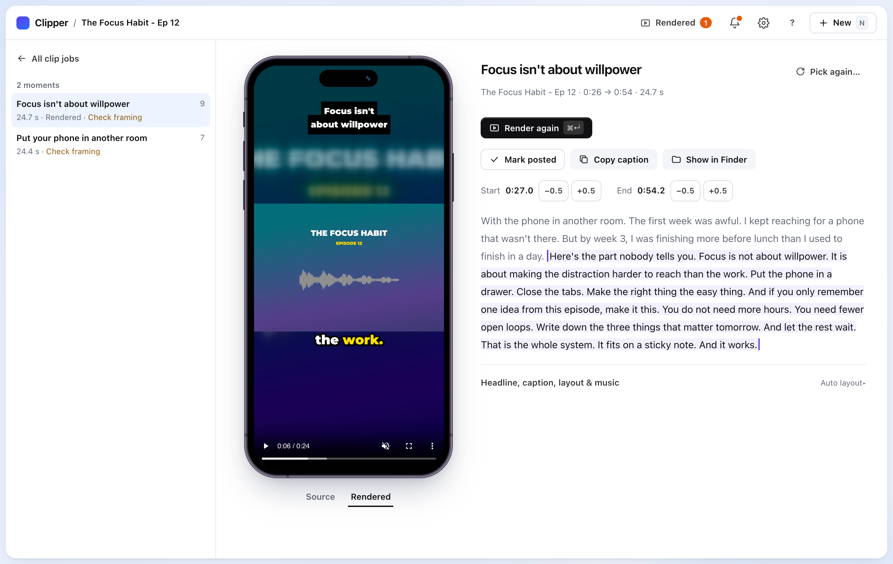

# LibreClipper

An open-source podcast clipper that runs on your own computer. Drop in a long video and get
vertical clips for TikTok, Reels and Shorts.



- **AI picks the moments.** You review them before anything renders.
- **The crop follows whoever is talking**, with word-by-word captions, a headline and an
  optional creator credit burned in.
- **Everything else is local.** Transcription, face tracking and rendering run on your
  computer. Nothing is ever posted for you.

## Get started

You need an Apple Silicon Mac (M1 or later) with `git`, and an API key from an AI provider
(Anthropic, OpenAI, Google Gemini and others work).

1. **Download and start it.** In Terminal:

   ```bash
   git clone https://github.com/yukitanakachez/libreclipper.git
   cd libreclipper
   ./start
   ```

2. **Wait for the first run.** It downloads what Clipper needs (about 1 GB) into the project
   folder, then opens Clipper in your browser. This takes a few minutes, once.

3. **Add your API key.** Clipper opens on **Set up Clipper**. Choose your AI provider, paste
   its key, press **Check key & list models**, pick a model, then press **Use**.

4. **Start a job.** Press **New**, drop a video onto the drop area (or click it to choose
   one), and press **Start**. The first video is slower, because the speech-to-text model
   (about 1.5 GB) downloads once.

5. **Render your clips.** When the job says it needs you, open it, pick a moment, and press
   **Render**. Finished clips are in `jobs/<job-id>/out/`, each with a `.txt` holding its
   caption and hashtags.

Next time, just run `./start` again. There is no file to edit and nothing to install
system-wide: deleting the folder removes Clipper completely.

If something looks wrong, the **Settings** page (the gear) lists what is missing and how to
fix it.

## What it costs

Clipper is free. The only paid part is the AI provider choosing the moments: with Claude,
roughly $0.10–0.40 per 90-minute episode depending on the model.

## Using the app

**The board** shows every job, grouped into **Needs you**, **Working** and **Finished**.

**New** (N) starts a job from a video file. **Creator** is optional: type an @handle and it is
shown as the credit on each clip and added as a hashtag.

**A job** lists its moments on the left, best first. For the selected moment you can:

- trim it by clicking a word in the transcript (start) or ⇧-clicking one (end);
- fix a misspelled word by double-clicking it;
- change the headline, caption, layout and music;
- **Render** it (⌘↵). Clips render one at a time while you keep working.

**Rendered** (top bar) lists every finished clip under **Not posted**, **Posted** and **All**.
**Mark posted** is your own record of what you have uploaded; Clipper never posts anything.

| Keys | Does |
|---|---|
| J / K | next / previous job or moment |
| ↵ | open |
| ⌘↵ | render the selected moment |
| ⌘Z | undo a trim |
| N | new job |
| ? | show all shortcuts |

To open Clipper without the terminal, run `.venv/bin/clipper app` once: it puts
**Clipper.app** in `~/Applications`.

## Campaigns

A campaign is a set of defaults for one creator: credit, hashtags, clip length, caption
colour, music and pacing. **Any video** works out of the box. To make your own, copy
`campaigns/example.yaml` to `campaigns/<creator>.yaml` and edit it:

```yaml
name: Example Podcast
credit: { enabled: true, handle: "@examplepod", position: below_headline }
clip_length: { min: 20, max: 60 }
required_hashtags: ["#examplepod"]
vocabulary: ["Jane Doe", "Acme"]     # names to spell correctly in captions
captions: { accent_color: "#FFE500", uppercase: false }
pacing: { cut_pauses: true, max_pause: 0.3, speed: 1.1 }
```

`vocabulary` is worth filling in: it stops guest names being misspelled in the captions.

## More

- [docs/reference.md](docs/reference.md): the command line, optional settings, manual setup,
  other systems, and how a job is stored.
- [CONTRIBUTING.md](CONTRIBUTING.md): how to run the tests and send a change.
- [SECURITY.md](SECURITY.md): where your API key is kept and how to report a problem.

## Credits

- Captions use [Montserrat](https://github.com/JulietaUla/Montserrat) (SIL Open Font License,
  `assets/fonts/OFL.txt`).
- Video work is done by [FFmpeg](https://ffmpeg.org). Clipper downloads a static build from
  [ffmpeg.martin-riedl.de](https://ffmpeg.martin-riedl.de); it is a separate, GPL-licensed
  program, not part of Clipper.
- Speech-to-text is [Whisper](https://github.com/openai/whisper) (mlx-whisper or
  faster-whisper). Faces are found with Google's
  [MediaPipe](https://developers.google.com/mediapipe).
- Provider logos come from [Simple Icons](https://simpleicons.org) (CC0). The names and logos
  belong to their owners; Clipper is not affiliated with or endorsed by any of them.

## License and legal

MIT: see [LICENSE](LICENSE).

Clip only videos you own or have the creator's permission to clip. Clipper does not download
videos from YouTube or anywhere else: you bring the file.
